<!-- The screenshots are rendered by the game itself: `cargo test --lib write_readme_screenshots -- --ignored`
     rewrites docs/screenshots/*.svg. Do not edit them by hand. -->
# ABRAXAS

A 1999 BBS hacker game that dreams its own levels.

It is 23:00 on 12/31/1999 in Port Hecate, a drowned-coast megacity where cyberdecks dial into the phone network and the phone network is a shared lucid dream. Your sister Wren, sysop of NIGHT SHIFT BBS, vanished on 12/10/99 with her phone off the hook. You dial her board, the line crosses, and you reach ABRAXAS, a board that should not exist. There is no hanging up: every Goodbye leads one level deeper.

The game is a terminal UI styled after a late-90s ANSI BBS: message bases, file libraries, door games, a user list, a sysop to page and an IRC network of fserv bots. You hack hosts through shell commands and ICE mini-games (WORDLOCK, BREACH, PHREAK, DAEMON, ROUTER, DUEL). Between levels you fall through procedural visions (tunnels, plasma, fire, mandalas) and the I Ching casts the omen of the level you land in. Every level is randomised. A local or remote language model writes the words (boards, files, hosts, interludes) and continues the story for ever; without one, an offline generator draws from the story pack's word bank so the game is always playable.

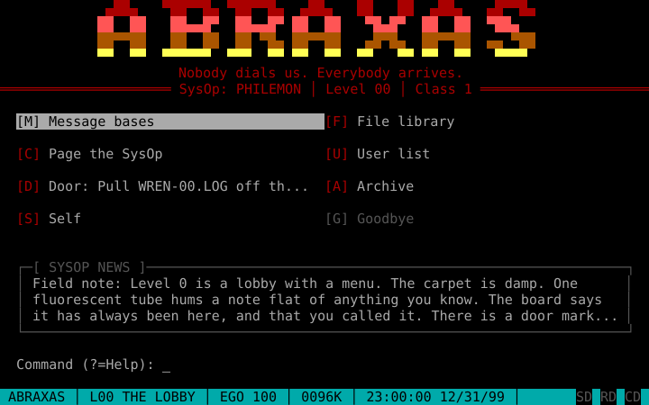

## Install and run

You need a terminal of at least 80x25 with truecolor (16 colours also work), on macOS or Linux.

```
brew install jamescarr/tap/abraxas     # prebuilt binary, macOS and Linux
cargo install --locked abraxas-bbs     # from crates.io; installs the `abraxas` command
abraxas                                # play (flags below)
```

To build from source you need a Rust toolchain; the repo pins it with [mise](https://mise.jdx.dev):

```
mise install
mise run play                      # release build, then play (AI on, local Ollama)
mise run play -- --offline         # no AI at all
mise run check                     # fmt + clippy + tests (what CI runs)
mise run ans                       # download ANSI artpacks into ./ans (art for the hidden line)
```

Without mise: `cargo run --release -- [flags]`.

| Flag | Meaning |
|---|---|
| `--offline` | never call the AI; build every level from the pack's pool |
| `--seed N` | run seed (a new game picks a random one; the same seed dreams the same offline levels) |
| `--pack DIR` | play a story pack from a directory instead of the built-in "The Rollover" |
| `--model M`, `--base-url URL` | AI model and OpenAI-compatible endpoint |
| `--calm` | no flicker, glitch, dissolve or CRT effects; visions are frozen (text still types) |
| `--baud N` | modem speed; text arrives at N/10 characters per second, 0 is instant (default 9600) |
| `--ans-dir DIR` | directory of `.ANS`/`.ICE` artpack files for the hidden line (default `./ans`) |
| `--socket PATH` | the hidden line's Unix socket (default `<data dir>/abraxas.sock`) |

Other commands: `abraxas pack check [DIR]` validates a story pack; `abraxas pack dream [--levels N] [--choose integrate|repress|neutral|random]` generates levels headlessly with the real director and prints them (`mise run dream`).

## How to play

1. Boot the terminal program, pick **NIGHT SHIFT BBS** from the dialing directory, and let the line cross. Register a handle (your persona) and a real name (the self: only the Shadow and Wren use it).

   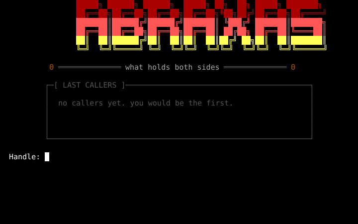

2. On a level you arrive at the level card, then the BBS menu. Read the **message base** and the **file library** for clues and programs, **page the SysOp** to chat, check the **user list**, hang out on **IRC** (below), then open the **door**: a host you must break into.

   | | |
   |---|---|
   | 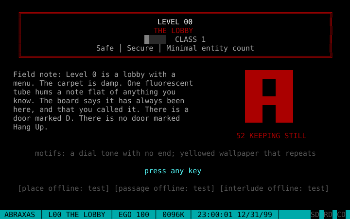 | 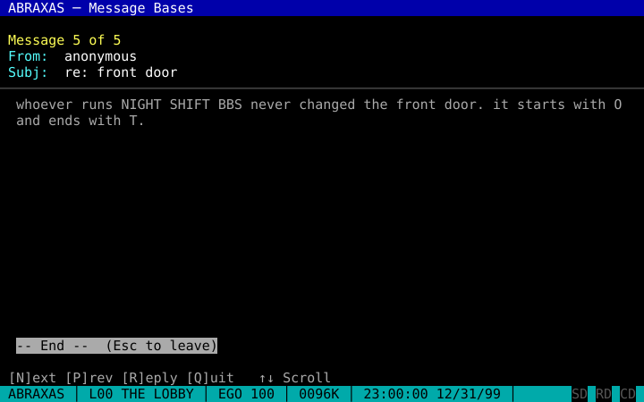 |

   **IRC** (`[I]` on the menu) is the level's network: three channels of chatter from the pack's word bank and a few `@` bots, the **fservs**, that sell files and programs for RATIO. `/list` and `/join #chan` move between channels, `/fserv <bot>` shows a bot's stock and `/get <n>` buys an item. An open fserv sells at once. A locked one sells nothing until you crack it: `/hack <bot>` plays one of the host's ICE mini-games (BREACH, PHREAK or DAEMON), and `/teardrop <bot>` crashes it outright for one charge of `TEARDROP.SH`, which the open fserv sells. A cracked fserv's stock is free. It is worth the risk: `.NFO` files give away half of the level's front-door password, zines teach the game's own hacking techniques, and programs fill your deck. What you buy is kept with the run (`/files`, `/read <n>`); `/help` lists every command.

   The IRC trace meter belongs to the visit: it starts at 0% and does not fall on its own. Every `/hack` costs 5 before the game starts, every slip or `Esc` inside it costs more, and `TEARDROP.SH` costs 15. At 100% the server K-lines you: EGO -20 and back to the menu.

   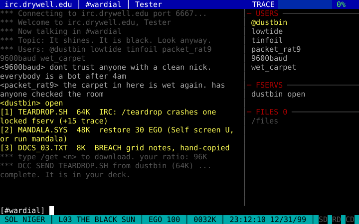

   | | |
   |---|---|
   | 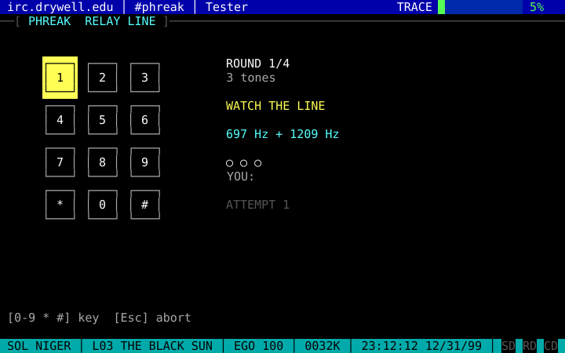 | 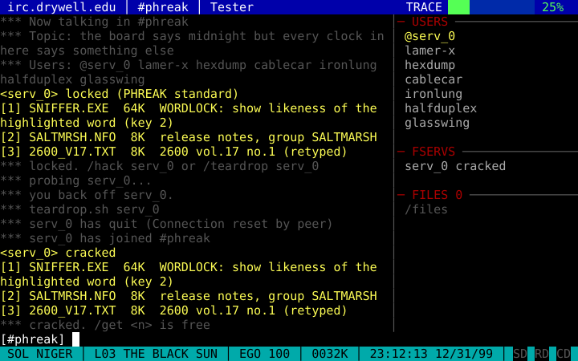 |
   | 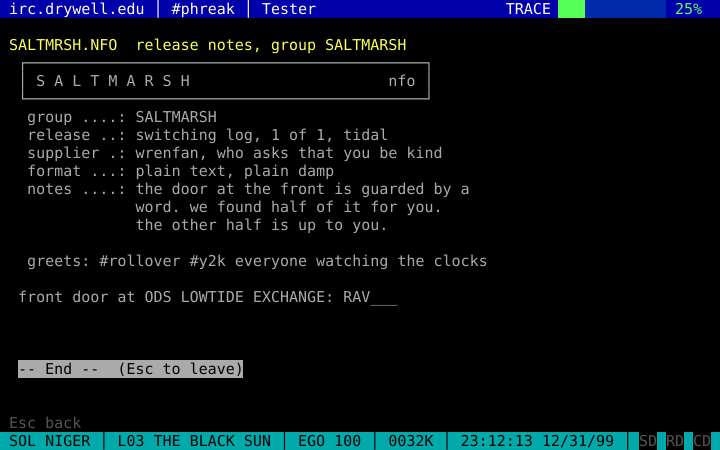 | 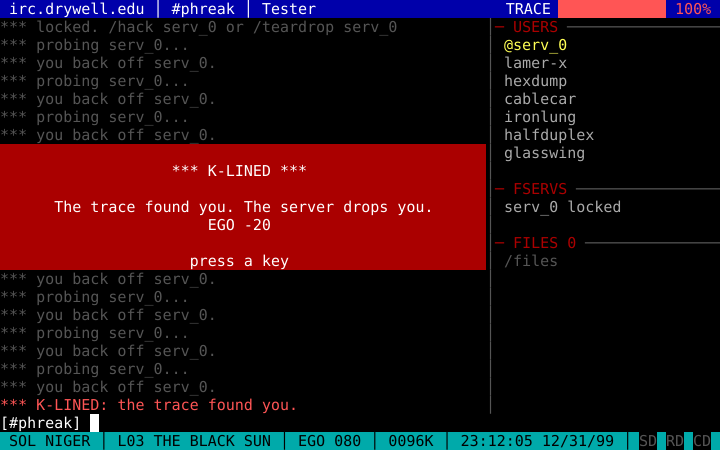 |

3. In a host you type shell commands (`help` lists them): `scan`, `ls`, `cat`, `connect <node>`, `get <file>`, `put PAYLOAD.PIF`, `ps`, `kill <pid>`, `bounce`, `run ghost`, `deck`, `logout`. Every command raises the trace; at 100% you get DUMP SHOCK (EGO -20) and are thrown back to the menu. `scan` names each adjacent guard and how tough it is (`soft`, `standard`, `hardened`); guards you meet are ICE mini-games. A DAEMON gate is a sandboxed login on the host's own OS: solve it by typing real 1990s commands (`ps`, `kill <pid>` on unix; `SHOW SYSTEM`, `STOP/ID=<pid>` on a VAX; `STATUS`, `CANCEL <job>` on a mainframe; `MEM /C`, `ATTRIB -H` on DOS). `Tab` inside it buys a hint for 4 trace. BLACK ICE duels come in three classes - WOLF (lunges), EYE (its gaze cannot be blocked, but a MIRROR reflects it double) and HYDRA (bites and regrows) - and each attack plays an animation (`--calm` disables them). The `re: front door` password post is a different kind of clue every level: easy masks early, vaguer hints (first/last letter, vowel count, a misleading rumour, nothing) deeper in.

   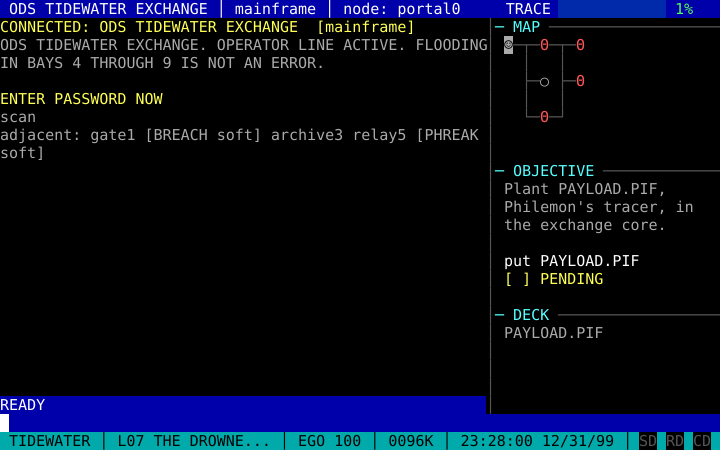

   | | |
   |---|---|
   | 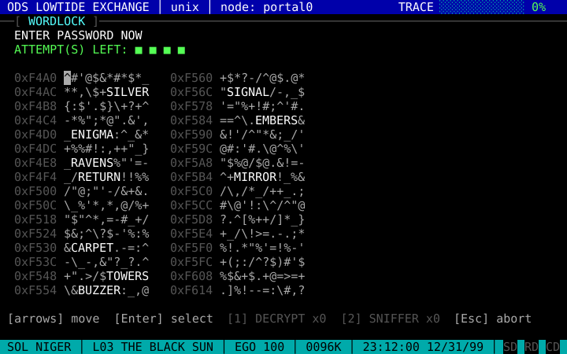 | 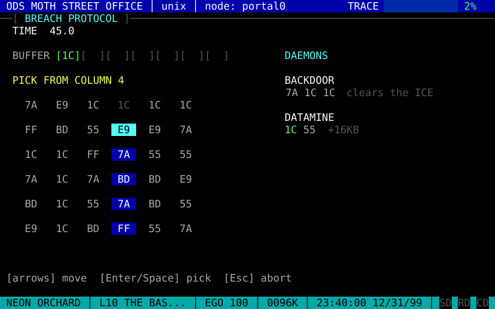 |
   | 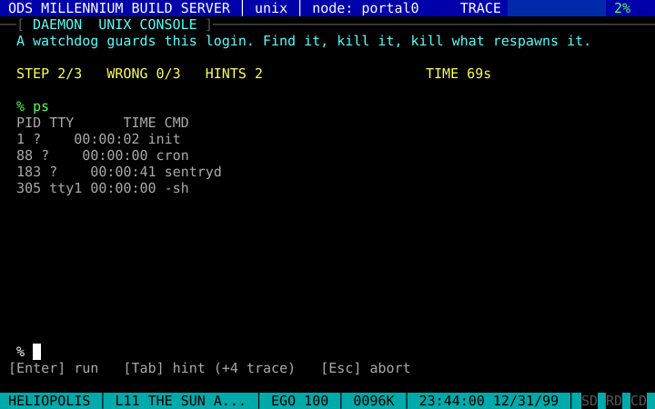 | 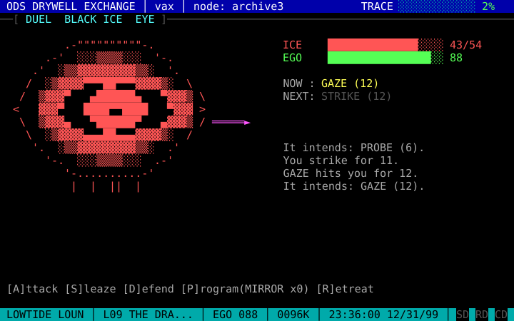 |

4. Finish the objective (retrieve a file, plant a payload, or crash a daemon), read what the payload reveals, make the choice it presents, jack out, and take **Goodbye** to fall to the next level.

   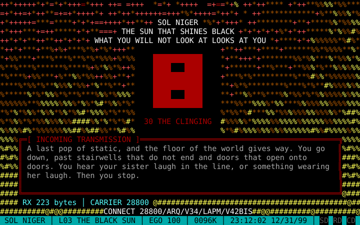

Stats: **EGO** (health, +10 on every arrival; at 0 the run ends and the save is deleted), **RATIO** (KB credit earned from doors, spent on programs in the file library and on IRC fservs), **INTEGRATION** (your stance toward the Shadow, -10 to 10; it decides the ending), **DECK** (programs: DECRYPT, SNIFFER, BUFFER, GHOST, ICEPICK, MIRROR, MANDALA, METRONOM, and TEARDROP, which only IRC sells; plus the four DUEL attacks WINNUKE, SMURF, SYNFLOOD and PINGOD, which only the hidden line teaches).

Levels 0-15 carry the authored story in four alchemical acts (NIGREDO, ALBEDO, CITRINITAS, RUBEDO); after an ending you can continue into THE UNDERBOARD, endless AI levels.

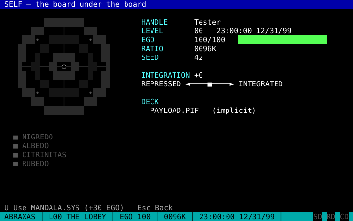

### The hidden line

While you play, the game also listens on a Unix socket: `abraxas.sock` in the data directory (`~/Library/Application Support/abraxas/` on macOS, `~/.local/share/abraxas/` on Linux; `F1` shows the exact path, with the home directory as `$HOME`; `--socket PATH` moves it). Open a second terminal and connect with `socat - "UNIX-CONNECT:$HOME/Library/Application Support/abraxas/abraxas.sock"` or `nc -U "$HOME/Library/Application Support/abraxas/abraxas.sock"` (the macOS path has a space, so quote it). Before you are logged in it answers `NO CARRIER`; afterwards every board (level) has its own hidden server, and `HELP` lists its commands:

- `TAP` plays **DECODE THE TRUNK** against the host's PHREAK relay (the guard that says WATCH THE LINE). The server prints the relay's DTMF tone pairs and a keypad grid; you type the keys the tones encode. A hit plants a **backdoor**: when you open the door, the relay is already cleared. Three misses lock the backdoor for that board. Hosts at danger 1 have no relay to tap.
- `DIR`, `TYPE <name>` and `GET <name>` browse a zine directory: three pieces of ANSI art and one article, picked per board from the run seed and the level. `TYPE` plays art at your modem speed (`--baud`; any line skips it). The art is redrawn through the same 80-column interpreter as the in-game viewer and sent as explicit rows, so it looks right in a terminal of any width (a piece that animates with cursor moves arrives as its final picture). `GET` adds the original file to your run's files: `/files` on IRC lists it and `/read <n>` opens it. `.ANS` and `.ICE` files open in a full-screen viewer that replays them at modem speed, animations included, and scrolls (`Up`/`Down`, `PgUp`/`PgDn`, `Esc` leaves; any key finishes the drawing).
- Reading an article teaches a DUEL attack for the rest of the run. Fire it with `1`-`4` once per duel against BLACK ICE (the Shadow is not a box): `WINNUKE.EXE` hits for 20, `SMURF.EXE` returns twice the announced hit (at least 8), `SYNFLOOD.EXE` hits for 6 and the ICE loses its turn, `PINGOD.EXE` hits for 30 and costs you 8 EGO.

The art comes from a directory of real artpack files: `[ans] dir` in `config.toml` (default `ans`, `--ans-dir DIR`). `mise run ans` downloads classic ACiD, iCE and Blade packs from [16colo.rs](https://16colo.rs) into `./ans` (git-ignored; needs `curl` and `unzip`). Each board picks three of the files at random and shows their SAUCE credit. With no files in the directory the pool's inline `[[zine_art]]` pieces are offered instead.

### Controls

| Where | Keys |
|---|---|
| Everywhere | `F1` or `?` help (not inside text inputs), `Ctrl+C` / `Ctrl+Q` / `Alt+X` ask `Hang up? [Y/n]` (Y saves and exits), `Esc` goes back |
| Menus | letter hotkeys, arrows, `Enter` |
| Viewers | `Up`/`Down`, `PgUp`/`PgDn`, `Space` |
| Text and the shell prompt | `Left`/`Right`/`Home`/`End`/`Backspace`/`Delete`, history with `Up`/`Down`, `Tab` completes commands, node ids and file names, `Ctrl+L` clears |
| IRC | slash commands (`/help` lists them), `PgUp`/`PgDn` scroll the log, `Esc` clears the line, then leaves |
| DUEL | `A` attack, `S` sleaze, `D` defend, `P` program, `R` retreat, `X` accept (Shadow), `1`-`4` the zine attacks you learned on the hidden line |
| Any transmission | any key completes the current text |

## AI setup

The default is a local [Ollama](https://ollama.com):

```
ollama pull qwen3.8
OLLAMA_NUM_PARALLEL=2 ollama serve
```

While the chat screen is open the game holds back the prefetch: a next-level job in flight is cancelled and requested again when you hang up, so a reply does not queue behind a multi-minute level even on a server that runs one request at a time (`qwen3.8`'s runner does). A job for the level you are on still runs, and `OLLAMA_NUM_PARALLEL=2` keeps a reply from waiting for it on runners that allow two. The prompts plus the longest reply need about 6K tokens of context; if your Ollama's default context is smaller, start it with `OLLAMA_CONTEXT_LENGTH=8192`. The game prefetches level N+1 while you play level N, never blocks on the AI (any failure after retries switches that part to the offline generator, and the modem lights show it), and keeps the story consistent with a digest of your choices. `qwen3.8` has the best prose but is slow: measured on an M4 Pro (48 GB) it runs at 5-7 tokens/s, so a level's place takes about 4 minutes, its passage about 2 and its interlude under a minute (`abraxas pack dream` prints each part's source and time). The prefetch hides most of that while you play a level, but if you fall faster than it writes, the Descent waits and then (after `timeout_secs`) fills the missing parts from the offline generator. `abraxas --model llama3.2:3b` is a much faster, rougher alternative: about 14 s for a place, 10 s for a passage, 1 s for an interlude. The place the AI is asked for is deliberately small (3 posts, 2 text files, 2 host files, bodies of at most 400 characters) to keep generation time down.

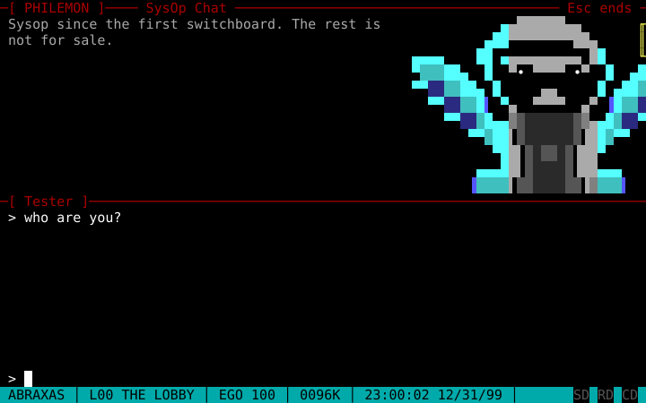

Any OpenAI-compatible server works: set `base_url`, `model` and, if it needs a key, `api_key_env` to the NAME of an environment variable holding it.

## Configuration, saves and logs

`config.toml` lives in the config directory; every key is optional and CLI flags override it:

```toml
[ai]
enabled = true
base_url = "http://localhost:11434/v1"
model = "qwen3.8"
chat_model = ""                 # empty = model
api_key_env = ""                # env var name holding a key; empty = no auth header
temperature = 0.9
reasoning_effort = "none"       # "" = omit
response_format = "json_schema" # json_schema | json_object
timeout_secs = 300
[display]
baud = 9600                     # 0 = instant
calm = false
crt = true
truecolor = "auto"              # auto | always | never
[ans]
dir = "ans"                     # .ANS/.ICE artpacks for the hidden line (mise run ans fills ./ans)
```

A syntax error in `config.toml` is printed to stderr and the game exits with status 1 before the terminal is touched.

Files: `ABRAXAS_HOME`, when set, holds everything. Otherwise macOS uses `~/Library/Application Support/abraxas/`, Linux uses `~/.config/abraxas` (config) and `~/.local/share/abraxas` (data). Inside: `config.toml`, `saves/<handle>.json` (one run per handle, written atomically), `callers.json` (the last 20 callers and obituaries), and `abraxas.log` (truncated at each launch; set `ABRAXAS_LOG=debug` to log full prompts and responses).

Quitting mid-level saves and resumes at the BBS menu with the door still open.

## Writing a story pack

A story pack is the starting story. You write the first levels, the cast and the voice; the AI director adapts your story to the player's choices and keeps it going. Without an AI, the offline generator draws from your pack's word bank (`pool.toml`), so a pack is always playable.

Copy `packs/_template/` to begin: every key in it is commented, and it is the second reference to this section. The built-in pack, `packs/rollover/`, is a full example.

```
abraxas --pack path/to/my-pack          play a pack from a directory
abraxas pack check [DIR]                validate a pack (the built-in pack when DIR is omitted)
```

### Layout

```
my-pack/
  pack.toml         identity, voice, motifs, acts, the endless tail      (required)
  canon.md          the setting, second person, at most 1500 words       (required)
  cast.toml         characters                                           (required)
  anchors/NN-slug.toml  authored levels, one per file
  pool.toml         word bank for the offline generator                  (optional)
  art/*.txt         pipe-coded art                                       (optional)
```

A pack can be as small as `pack.toml`, `canon.md`, `cast.toml` and one anchor.

### pack.toml

```toml
id = "rollover"                  # ^[a-z0-9-]{1,32}$
title = "ABRAXAS: The Rollover"  # not empty
author = "James Carr"
version = "1"
style = """at most 120 words of voice rules sent to the AI with every call"""
motifs = ["wet carpet", "a payphone ringing"]    # at least 8; two are drawn per level
room_kinds = ["a school district board"]         # at least 8; one is drawn per level
start_clock = "23:00:00"         # HH:MM:SS, the in-world time at level 0
minutes_per_level = 4            # at least 1

[[act]]                          # one or more, contiguous from depth 0
id = "nigredo"                   # ^[a-z0-9_]{1,24}$, unique
name = "NIGREDO"
depths = [0, 3]                  # inclusive; no gap, no overlap, from <= to
palette = "nigredo"              # nigredo | albedo | citrinitas | rubedo | prism
goal = "at most 160 characters"
direction = """at most 120 words for the AI"""
default_vision = "fire"          # tunnel | plasma | mandala | fire | ouroboros | starfield | mirror

[endless]                        # what happens after the last act
enabled = true                   # false: the story ends there
name = "THE UNDERBOARD"          # name, goal and direction are required when enabled
palette = "prism"
goal = "..."
direction = """..."""
default_vision = "starfield"
```

### cast.toml

```toml
[[character]]
id = "philemon"                  # ^[a-z0-9_]{1,24}$, unique
handle = "PHILEMON"              # "{shadow}" only for the shadow archetype (at most one)
archetype = "wise_old_man"       # persona | shadow | syzygy | anima | animus | wise_old_man
                                 # | great_mother | trickster | self | child | hero
from_depth = 0                   # first depth where the character exists
focusable = true                 # may be picked as a level's focus
description = "at most 60 words"
voice = "at most 40 words"
art = "philemon.txt"             # optional; must exist in art/
fallback = ["...", "...", "..."] # chat lines used without an AI, at least 3

[[character.eliza]]              # keyword rules for the no-AI chat
keywords = ["wren", "sister"]    # first group with a matching keyword answers
replies = ["...", "..."]         # must not be empty
```

### Anchors

An anchor is an authored level at a fixed depth, in `anchors/NN-slug.toml`. Depths are unique and inside the acts (beyond the last act only when the endless tail is enabled). Every key except `depth` is optional.

```toml
depth = 3
ai = "adapt"                     # adapt (default) | off: never call the AI for this level
title = "THE BLACK SUN"          # at most 40
bbs_name = "SOL NIGER"           # at most 24
tagline = "..."                  # at most 60
sysop = "shadow"                 # a cast id, or a handle ^[A-Za-z0-9_-]{2,16}$
danger = 2                       # 1..5; default is 1 + depth/4, at most 5
focus = "shadow"                 # a cast id
vision = "fire"
programs = ["GHOST.COM"]         # DECRYPT.COM SNIFFER.EXE BUFFER.EXE GHOST.COM
                                 # ICEPICK.EXE MIRROR.EXE MANDALA.SYS
password = "RAVENS"              # A-Z, as long as the WORDLOCK word for `danger`
level_card = """..."""           # at most 320
required = """facts the AI must keep"""
keep = ["a line of the beat"]    # each must be in `beat`; the adapted beat keeps it word for word
interlude = """..."""
beat = """..."""                 # at most 700
captions = ["...", "...", "..."] # at most 3, each at most 48
summary = "..."                  # at most 200
words = ["RAVENS", "CINDER"]     # extra password candidates, each the same length

[host]
name = "ODS LOWTIDE EXCHANGE"    # at most 40
os = "unix"                      # unix | vax | mainframe | dos
banner = "..."                   # at most 160
objective_kind = "retrieve"      # retrieve | plant | crash
objective = "..."                # at most 100
target_file = "WREN-01.LOG"      # 8.3 name
target_daemon = "pleroma"        # crash objectives only; lowercase process name
objective_ice = "shadow"         # breach | black | shadow
nodes = 5                        # 3..8
node_names = ["..."]             # each at most 24
ice_names = ["..."]              # each at most 20

[[post]]                         # from <= 16, subject <= 40, body <= 600
from = "..."
subject = "..."
body = """..."""

[[text_file]]                    # BBS file library; name is 8.3, description <= 40, body <= 900
name = "HOWTO.TXT"
description = "..."
body = """..."""

[[host_file]]                    # files found on the host; same fields
name = "SHIFTLOG.TXT"
description = "..."
body = """..."""

[choice]                         # 2 or 3 options; prompt <= 160, option text <= 70
prompt = "..."
[[choice.option]]
text = "..."
stance = "integrate"             # integrate | repress | neutral
flags = ["answered_shadow"]      # at most 2, ^[a-z][a-z0-9_]{0,31}$

[[exit]]                         # all three, once each, text <= 60
kind = "calm"                    # calm | deep | mirror
text = "..."

[[ending]]                       # at an anchor that ends the story or the arc
id = "individuation"
title = "INDIVIDUATION"
when_stance = "integrate"
min_integration = 3              # optional
max_integration = 10             # optional
vision = "mandala"               # optional, default mandala
text = """..."""
```

Endings are tried in file order; the first whose stance matches the player's choice and whose integration bounds hold wins. If an anchor has endings, every option of its choice needs at least one ending for its stance.

How an anchor mixes with the AI:

| Class | Fields | Rule |
|---|---|---|
| Locked | `title`, `bbs_name`, `tagline`, `sysop`, `danger`, `focus`, `vision`, `programs`, `password`, every `[host]` key, `choice`, `exit`, `ending` | When present, your value wins and any AI value is ignored. |
| Adapted | `level_card`, `beat`, `interlude`, `captions`, `summary` | With `ai = "adapt"` the AI is told to keep every fact and reword to fit the story so far, together with `required`. A valid AI result is used, otherwise your text. An AI beat is only valid if it contains every `keep` line word for word (case and punctuation aside); `pack check` makes sure your own beat contains them. |
| Appended | `post`, `text_file`, `host_file`, `words` | Your entries always come first; the AI or the pool fills the remaining slots (3 posts plus the engine's clue post, 2 text files, 2 host files; AI text bodies are cut at 400 characters). |
| Generated | every level without an anchor | Fully AI-generated, or built from the pool offline. |
| Continued | depths beyond the last act, when `endless.enabled` | AI levels forever, using the `[endless]` goal and direction plus the story so far. |
| Finished | the last act's final depth, when `endless.enabled = false` | After that level's choice a matching ending plays, otherwise the generic `END OF LINE`. The run is marked complete. |

With `ai = "off"` the AI is never called for that level and missing fields come from the offline generator.

### pool.toml and inheritance

`pool.toml` is the offline generator's word bank. Any list that is missing or empty is inherited from the built-in pool, list by list, so you only write what you want to change.

| Key | Contents |
|---|---|
| `titles`, `bbs_names`, `taglines` | at most 40, 24 and 60 characters |
| `level_cards` | at most 320; may use `{motif}` |
| `sysops` | handles `^[A-Za-z0-9_-]{2,16}$` |
| `host_names`, `node_names`, `ice_names` | at most 40, 24 and 20 |
| `daemons` | lowercase process names |
| `interludes` | may use `{exit}` |
| `beats`, `captions` | at most 700 and 48 |
| `words_5` ... `words_8` | uppercase words matching `^[A-Z]{N}$` |
| `eliza`, `eliza_fallback` | `{ keywords, replies }` groups and fallback lines for the generic NPC sysop chat |
| `irc_servers` | server host names, at most 40 characters |
| `irc_channels` | channel names matching `^#[a-z0-9_-]{2,20}$` |
| `irc_nicks`, `irc_bots` | handles `^[A-Za-z0-9_-]{2,16}$`: the chatterers and the fserv bots |
| `irc_chatter` | chat lines, at most 70 characters; may use `{handle}`, `{shadow}` and `{real_name}` |
| `zine_art` | `[[zine_art]]` pieces (`name`, `description`, `body`): pipe-coded art, at most 78x20, shown on the hidden line when the ANS directory is empty |
| `zine_article` | `[[zine_article]]` entries: `name`, `description`, `attack` (`WINNUKE.EXE`, `SMURF.EXE`, `SYNFLOOD.EXE` or `PINGOD.EXE`) and `body`; reading one on the hidden line teaches that DUEL attack |

`[[post]]`, `[[text_file]]`, `[[host_file]]` and `[[exit]]` use the same fields as in anchors; a `[[choice]]` with `[[choice.option]]` must offer exactly one option per stance, and the exits must include every kind.

`[[irc_nfo]]` (release notes; the engine appends the clue to the level's front door) and `[[irc_zines]]` (articles about the game's hacking techniques) use the same fields as `[[text_file]]`.

### Placeholders

Authored text can contain `{handle}` (the player), `{shadow}` (the player's Shadow handle) and `{real_name}`. Pool level cards may also use `{motif}` and pool interludes `{exit}`. Write a literal brace as `{{` or `}}`. Any other `{...}` is an error.

### Pipe codes and art

Authored text and art use pipe codes for colour: `|00` to `|15` set the foreground to a DOS colour, `|16` to `|23` set the background to DOS colours 0 to 7. The colour lasts to the end of the text block. A `|` not followed by two digits in range is literal.

| Code | Colour | Code | Colour |
|---|---|---|---|
| `\|00` | black | `\|08` | dark gray |
| `\|01` | blue | `\|09` | light blue |
| `\|02` | green | `\|10` | light green |
| `\|03` | cyan | `\|11` | light cyan |
| `\|04` | red | `\|12` | light red |
| `\|05` | magenta | `\|13` | light magenta |
| `\|06` | brown | `\|14` | yellow |
| `\|07` | light gray | `\|15` | white |

Backgrounds: `|16` black, `|17` blue, `|18` green, `|19` cyan, `|20` red, `|21` magenta, `|22` brown, `|23` light gray.

Everything the game draws stays in the CP437 character set: ASCII, box drawing, blocks, shades and the smiley glyphs. Curly quotes, long dashes, the ellipsis character, accents outside CP437 and emoji are errors. Art lives in `art/*.txt`, at most 36 columns by 16 rows after the pipe codes are removed; `abraxas-logo.txt` (the login screen) may be 78 by 8. A character's `art` names a file in `art/`.

File names on the board and on hosts follow DOS 8.3: `^[A-Z0-9_-]{1,8}\.[A-Z0-9]{1,3}$`, for example `WREN-01.LOG`.

### Checking a pack

`abraxas pack check [DIR]` validates the pack in `DIR`, or the built-in pack. Every problem is listed, one per line, as `{file}: {field}: {message}`, and the exit code is 1:

```
anchors/03-black-sun.toml: depth: depth 0 already used by anchors/00-the-lobby.toml
anchors/15-the-center.toml: ending: option 2 (repress) has no ending
```

On success it prints `pack {id}: OK ({acts} acts, {anchors} anchors, {characters} characters, endless {on|off})` and exits 0. The checks cover the identity and clock in `pack.toml`; acts contiguous from depth 0; cast ids, shadow handle, art files and ELIZA lists; unique anchor depths, sysop and focus ids, 2 to 3 choice options, exactly three exits, endings for every option, password length for the danger class, and 8.3 names; every length limit above; CP437 text and art; art size; pool lists and placeholders.
